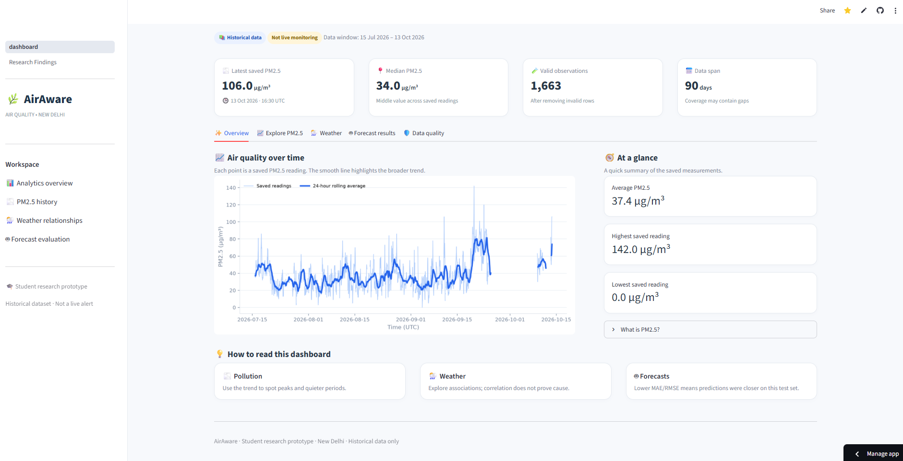

# 🌫️ AirAware — PM2.5 Analysis & Forecasting

**An end-to-end data science project exploring air pollution, weather relationships, and one-hour-ahead PM2.5 forecasting in New Delhi, India.**

[🚀 Live Dashboard](https://airaware-pm25.streamlit.app) · [📊 Model Evaluation](MODEL_EVALUATION.md) · [💻 GitHub Repository](https://github.com/AmardeepSingh2005/airaware-pm25-forecasting)

## Dashboard Preview



*AirAware's interactive dashboard for exploring historical PM2.5 measurements in New Delhi.*
## Overview

AirAware combines air-quality observations and weather data to explore PM2.5 patterns, analyze environmental relationships, and evaluate short-term forecasting methods.

The project emphasizes reproducible data preparation, exploratory data analysis, chronological evaluation, model comparison, and transparent reporting of limitations.

### Dashboard

Explore the interactive Streamlit dashboard to examine:

- **Overview:** key statistics and air-quality trends.
- **Explore PM2.5:** historical pollution patterns and distributions.
- **Weather:** weather conditions and their relationships with PM2.5.
- **Forecast results:** model predictions and evaluation metrics.
- **Data quality:** observation coverage and missing-data diagnostics.

**[Open the live AirAware dashboard →](https://airaware-pm25.streamlit.app)**

## Key Findings

The forecasting experiments produced an important result: more complex models did not automatically provide better predictions than a simple persistence baseline.

The following metrics come from the original chronological 80/20 holdout, containing 1,216 training examples and 304 test examples.

| Model | MAE (µg/m³) | RMSE (µg/m³) |
|---|---:|---:|
| **Persistence baseline** | **6.467** | **9.352** |
| Random Forest | 8.550 | 12.237 |

The persistence baseline predicts that the next-hour PM2.5 concentration will equal the current reading.

Additional experiments tested feature ablation, concentration-specific errors, a hybrid forecasting strategy, rolling means, trend extrapolation, and previous-day seasonal persistence. Persistence remained the strongest overall method across the evaluation procedures completed so far.

See **[MODEL_EVALUATION.md](MODEL_EVALUATION.md)** for detailed metrics, methodology, rolling-origin results, and limitations.

> **Research takeaway:** establish a strong baseline, evaluate models on chronological data, and report negative results honestly rather than assuming machine learning must improve accuracy.

## Research Questions

AirAware's broader research objectives are:

1. How accurately can PM2.5 concentrations be forecast?
2. Does incorporating weather information improve forecasting performance?
3. Can a model trained in one city generalize to another?
4. How can predictions and uncertainty be explained to users?

The current prototype focuses on one-hour-ahead forecasting in New Delhi. Next-day forecasting, cross-city generalization, and uncertainty estimation remain future work.

## Data Sources

| Component | Source |
|---|---|
| Air-quality observations | OpenAQ API v3 |
| Weather data | Open-Meteo Historical Weather API |
| Study location | New Delhi, India |
| PM2.5 sensor ID | `23534` |
| Observation period | 15 July–13 October 2026 |

### Data Quality Snapshot

- 1,663 valid PM2.5 observations in the collected pollution dataset.
- 2,184 hourly weather records downloaded.
- Approximately 77% coverage of expected hourly timestamps in the pollution series.
- 1,520 usable examples in the processed hourly forecasting dataset.

Missing pollution measurements and gaps between observations are important limitations. The project does not treat missing readings as real measurements.

## Forecasting Methodology

### Features

The one-hour-ahead forecasting dataset uses:

- Current PM2.5 concentration
- Previous-hour PM2.5 concentration
- Trailing three-hour PM2.5 mean
- Temperature and relative humidity
- Precipitation, wind speed, and wind direction
- Local forecast hour and day of the week

### Models Evaluated

The experiments include:

- Persistence baseline
- Random Forest regression
- Extra Trees regression
- Gradient Boosting regression
- Histogram-based Gradient Boosting
- Three-hour rolling mean
- Linear trend extrapolation
- 24-hour seasonal persistence
- Experimental threshold-based hybrid forecasting

### Evaluation Approach

The project uses chronological splits to preserve time order and prevent future observations from being used to train models evaluated on earlier periods.

Additional checks examine target timestamp alignment, missing intervals, consecutive hourly observations, feature ablation, and performance across rolling-origin evaluation periods.

MAE (mean absolute error) and RMSE (root mean squared error) are reported in µg/m³. Lower values indicate better predictive accuracy.

Detailed results for the different evaluation sample sizes are available in [MODEL_EVALUATION.md](MODEL_EVALUATION.md).

## Technology Stack

- **Language:** Python
- **Data processing:** Pandas, NumPy
- **Machine learning:** Scikit-learn
- **Visualization:** Matplotlib and dashboard charts
- **Interactive dashboard:** Streamlit
- **Data sources:** OpenAQ and Open-Meteo
- **Version control:** Git and GitHub

## Run Locally

### 1. Clone the repository

```bash
git clone https://github.com/AmardeepSingh2005/airaware-pm25-forecasting.git
cd airaware-pm25-forecasting
```

### 2. Create and activate a virtual environment

**Windows PowerShell**

```powershell
python -m venv .venv
.\.venv\Scripts\Activate.ps1
```

### 3. Install dependencies

```bash
python -m pip install -r requirements.txt
```

### 4. Launch the dashboard

```bash
python -m streamlit run app/dashboard.py
```

The dashboard uses data and report files from the project directories. Ensure the required files are present before launching it.

## Project Structure

```text
airaware-pm25-forecasting/
├── app/
│   └── dashboard.py
├── data/
│   ├── raw/
│   └── processed/
├── reports/
├── requirements.txt
├── prepare_hourly_dataset.py
├── train_model.py
├── baseline_forecast.py
├── weather_ablation.py
├── MODEL_EVALUATION.md
└── README.md
```

Additional scripts support data retrieval, data-quality checks, exploratory analysis, correlation analysis, and forecasting experiments.

## Limitations

- The study focuses on one monitoring location in one city.
- The observation period is limited and contains substantial gaps.
- Historical weather estimates are not direct measurements at the pollution sensor.
- Results may differ across locations, seasons, and pollution conditions.
- The tested machine-learning models have not consistently beaten persistence.
- Earlier test periods have been examined during iterative development; a future independent evaluation is still needed.
- Cross-city generalization, next-day forecasting, SHAP explanations, and calibrated uncertainty estimates remain future work.

AirAware is an educational research prototype. Its forecasts should not be treated as official environmental assessments or used as the sole basis for health decisions.

## Future Work

- Collect a longer and more continuous pollution time series.
- Preserve an untouched future test period for independent evaluation.
- Reassess forecasting accuracy as new data becomes available.
- Investigate model performance across different pollution conditions.
- Evaluate generalization across additional monitoring stations and cities.
- Add explainability and uncertainty estimation where appropriate.

## Project Status

AirAware has a working interactive dashboard, a processed hourly forecasting dataset, and documented model-evaluation experiments. The current evidence favors persistence over the tested machine-learning approaches.

The project records both successful findings and experiments that did not improve predictive accuracy.

**[Explore the live dashboard →](https://airaware-pm25.streamlit.app)**

**[Read the full model evaluation →](MODEL_EVALUATION.md)**
